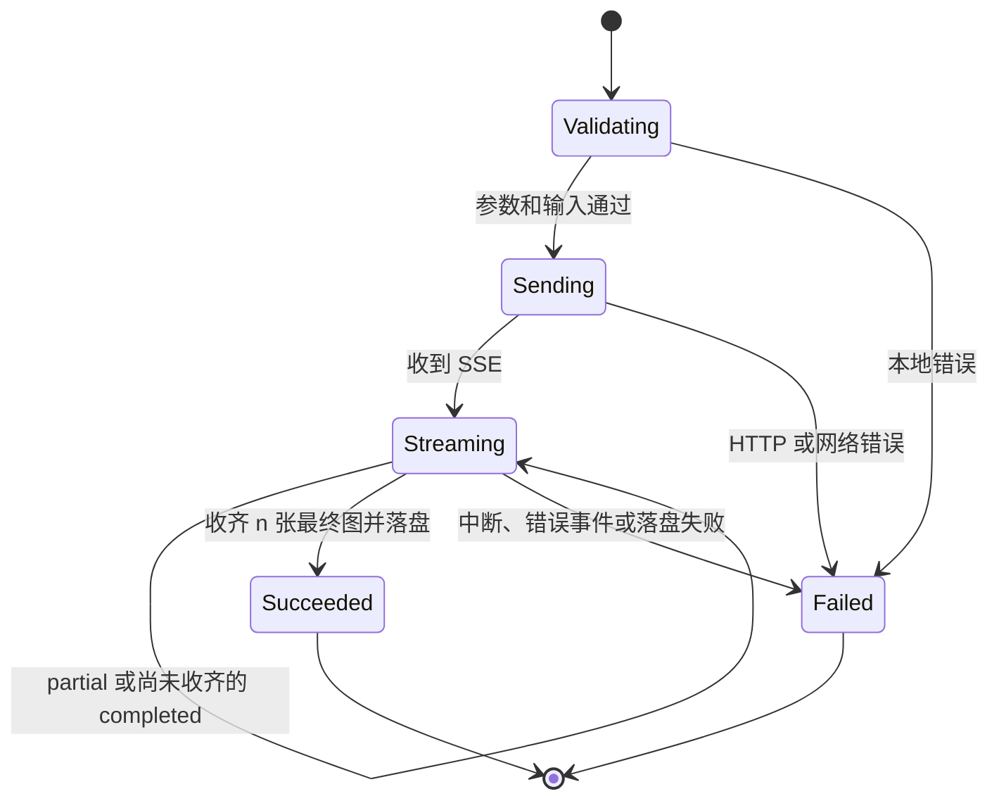

# OpenAI Images API 兼容接口设计

状态：设计审查完成，工作区已按本规格实现（0.12.0，尚未发布）。核对日期：2026-11-09。

本规格规定 image-gen CLI 调用 OpenAI 兼容网关时的请求、响应、流事件和用户可观察行为。基础编辑能力沿用 [图片编辑规格](image-edit.md)；后续扩展与兼容性变更以本规格为准。当前实现差异见 [能力对照](../api-coverage.md)。

## Problem Statement

现有 CLI 能生成和编辑常规位图，但未覆盖官方 Images API 的 SVG、GIF、markup、引用输入和流式响应。可选参数的默认值与上游不一致，响应元数据被丢弃，调用方也无法准确区分请求未执行、结果未知和生成成功后的本地失败。

## Solution

保留 `generate`、`edit` 命令，将官方请求参数映射为明确的 CLI 选项。生成使用 JSON；编辑根据输入来源和参数结构选择 multipart 或 JSON。未指定的可选参数省略，响应统一转为带元数据的本地产物，流式与非流式复用同一结果契约。

「兼容」分为两项：CLI 可以正确表达并解析接口契约；具体网关、模型和账户实际接受该请求。协议测试证明前者，实际服务验证记录证明后者。

## User Stories

1. 用户能通过官方参数控制生成和编辑，获得 PNG、JPEG、WebP、GIF 或 SVG 产物。
2. 用户能按给定顺序组合本地图片、URL、data URL 和 File ID，并选择 mask 或 markup。
3. 用户能接收流式预览和最终产物，脚本仍可获得单个 JSON 结果，也能选择逐行事件。
4. 用户能查看上游实际参数、用量和 request ID，并据错误阶段决定下一步。
5. 已有脚本能明确迁移默认值，网关特有的模型名仍可正常使用。

## Context / Authority

- [生成接口 G](https://developers.openai.com/api/reference/resources/images/methods/generate)。
- [编辑接口 E](https://developers.openai.com/api/reference/resources/images/methods/edit)。
- [使用指南 Guide](https://developers.openai.com/api/docs/guides/image-generation)。
- [生成流事件 GS](https://developers.openai.com/api/reference/resources/images/generation-streaming-events)。
- [编辑流事件 ES](https://developers.openai.com/api/reference/resources/images/edit-streaming-events)。
- [错误码](https://developers.openai.com/api/docs/guides/error-codes)。
- [仓库契约与发布约定](../../CONTRIBUTING.md)。

以上来源定义上游协议。本文的 CLI 名称、自动编码选择、JSON/JSONL 外层结构、退出码和迁移方式属于项目设计。文档冲突采用下文明确的兼容策略，不由模型名称猜测网关能力。

## Affected Surfaces

- CLI 参数、配置与帮助。
- HTTP 请求编码、响应解码、SSE 事件解析。
- 本地文件、stdout/stderr 和错误契约。
- 集成测试、README、CHANGELOG 和配套 image-gen skill。

## Contracts & Data

### 1. 入口、默认值与可选字段

| 入口 | HTTP 请求 | 必需输入 |
| --- | --- | --- |
| `generate [提示词]` | `POST /v1/images/generations`，JSON | prompt；从参数、环境变量或配置解析出的 model |
| `edit [提示词]` | `POST /v1/images/edits`，multipart 或 JSON | prompt；1–16 个图片输入；model 可省略 |

- prompt 沿用位置参数、stdin 和显式 `-`；发送前去除首尾空白，按发送值校验合法 UTF-8、非空、最多 32,000 个 Unicode 码点。stdin 保留资源读取上限，但它不替代字符数校验。
- 网关、鉴权、模型与输出目录沿用现有的参数、环境变量、配置优先级。生成缺 model 返回参数错误；编辑缺 model 时省略该字段，使用上游默认。CLI 不假定默认模型的名称。
- 参数保存「未设置」与「显式设置」两种状态。未设置的可选字段不发送；显式 false、0、auto 按原意发送。CLI 不主动构造 null。
- 因此缺省 size、quality 采用上游 auto；output_format、n、stream 分别采用上游 png、1、false。CLI 仅在校验组合关系时采用这些协议默认值，不为此把它们补进请求。
- 新增配置 `[defaults]` 的 size、quality，用于保存用户偏好及迁移旧默认值。显式 CLI 参数优先；其余新增参数首先通过命令行提供，不增加一组隐式环境变量。
- 同一个标量选项重复给出时沿用现有 CLI 的最后值；图片输入选项保留所有出现位置和顺序。

### 2. 参数映射

G/E 表示生成/编辑。表中限制是接口公共限制；模型专属限制见第 5 节。

| CLI | 上游字段 | 入口 | 类型与处理 |
| --- | --- | --- | --- |
| `--model` | model | G/E | 非空字符串；G 必需，E 可省略 |
| 位置参数或 stdin | prompt | G/E | 字符串，1–32,000 码点 |
| `--count` | n | G/E | 整数，1–10 |
| `--size` | size | G/E | auto 或正整数 WIDTHxHEIGHT |
| `--quality` | quality | G/E | low/medium/high/xhigh/max/auto；G 另允许旧模型的 standard/hd |
| `--format` | output_format | G/E | png/jpeg/webp/gif/svg；jpg 继续归一为 jpeg |
| `--background` | background | G/E | auto/opaque/transparent |
| `--output-compression` | output_compression | G/E | 整数，0–100 |
| `--moderation` | moderation | G/E | auto/low |
| `--complexity` | complexity | G/E | low/medium/high |
| `--frame-count` | frame_count | G/E | 整数，2–16 |
| `--frame-duration-ms` | frame_duration_ms | G/E | 整数，至少 20；服务端处理舍入和编码上限 |
| `--stream[=true\|false]` | stream | G/E | 布尔值 |
| `--partial-images` | partial_images | G/E | 整数，0–3；显式使用时要求 stream=true |
| `--safety-identifier` | safety_identifier | G/E | 字符串，最多 128 码点；不自动从用户信息生成 |
| `--svg-model` | svg.model | G/E | 非空字符串，与顶层 model 独立 |
| `--svg-reasoning-effort` | svg.reasoning.effort | G/E | none/minimal/low/medium/high/xhigh/max |
| `--input-fidelity` | input_fidelity | E | high/low；默认省略 |

`svg` 只有在子选项显式提供时才构造。G 的 svg 对象要求 model，因此生成时仅传 `--svg-reasoning-effort` 返回参数错误；E 的 schema 将 model 标为可选，编辑时按该定义编码。SVG 模型选择权限和具体 reasoning 挡位由上游判断。

完整保留官方参数表中的旧接口表达能力：G 的 `--response-format url|b64_json` 映射到 `response_format`，`--style vivid|natural` 映射到 `style`，G/E 的 `--user` 映射到 `user`。这些字段只在显式提供时发送，帮助中标为旧模型兼容或已弃用。GPT Image 对旧参数的拒绝原样返回；不在失败后自动删参数重发。`user` 与 `safety_identifier` 同时出现时均按输入发送，优先级由官方协议决定。

### 3. 图片、mask 与 markup

| CLI | 含义 | JSON 字段 |
| --- | --- | --- |
| 重复 `--image <文件>` | 本地原图或参考图 | 编为 data URL 后放入 images[i].image_url |
| 重复 `--image-url <URI>` | HTTP(S) URL 或 data URL | images[i].image_url |
| 重复 `--image-file-id <ID>` | 已上传图片 | images[i].file_id |
| `--mask <文件>` | 本地 mask | mask.image_url |
| `--mask-url <URI>` | mask URL/data URL | mask.image_url |
| `--mask-file-id <ID>` | 已上传 mask | mask.file_id |
| `--markup <文件>` | 本地标注层 | markup.image_url |
| `--markup-url <URI>` | 标注层 HTTPS URL/data URL | markup.image_url |
| `--markup-file-id <ID>` | 已上传标注层 | markup.file_id |

- 所有图片选项写入同一个有序列表。例如 `--image a.png --image-file-id file_b --image-url https://example.test/c.png` 必须得到 A、B、C 的顺序。
- 图片总数只计 images，不计 mask/markup。每个引用对象恰好有 image_url 或 file_id 之一，File ID 是非空的不透明标识。
- mask 三种来源互斥；markup 三种来源互斥；mask 与 markup 整体互斥。二者均关联第一张原图。
- 本地原图按内容识别 PNG/JPEG/WebP；SVG 不是受支持的编辑输入。mask 和 markup 为 PNG。文件必须可读、非空、普通文件；目录和管道在读取前拒绝。
- 文件限额统一以本规格的保守值定义为严格小于 50,000,000 字节，帮助明确字节数，避免 MB/MiB 混用。原有 50 MiB 限制相应收紧，纳入迁移说明。
- 本地 mask 校验 alpha 通道和与第一张原图一致的宽高；保留现有 JPEG/WebP 原图加 PNG mask 的表达能力，由上游裁决该组合。
- 本地 markup 校验实际存在透明像素；其与原图经 EXIF 方向处理后的宽高必须一致，原图和标注层各不超过 16,777,216 像素。上传保留原始字节；校验不自动旋转或重绘图片。
- 远程引用只校验 URI 结构、协议、引用对象和长度；原图与 mask 接受 HTTP(S)，markup 仅接受 HTTPS 或 data URL；data URL 校验 MIME、base64 与解码内容的一致性，并应用同类本地输入的格式和大小限制。原图尺寸不可知时，相关跨图片检查交给上游；不为校验主动下载 URL 或调用 Files API。

### 4. 请求编码与传输

| 编辑请求内容 | 编码 |
| --- | --- |
| 所有图片、mask/markup 均为本地文件，且没有 svg 对象 | multipart/form-data |
| 任一输入使用 URL、data URL 或 File ID，或包含 svg 对象 | application/json |

Multipart 使用有序重复的 `image[]` 文件字段，mask/markup 是对应的单文件字段；其余标量字段使用官方字段名与字符串表示。PNG/JPEG/WebP 的 MIME 按文件内容确定。

JSON 使用 images 数组；混合输入中的本地文件转换成 data URL。按 E 的 image_url 限制校验编码后的 URI 长度不超过 20,971,520 字符，包括前缀；base64 膨胀不能按原文件大小忽略。超限时在请求前报错，提示使用本地 multipart 请求或已有 File ID。不会自动上传到 Files API，也不会改换来源顺序。

两种请求均提供可重新读取的请求体；大请求可暂存本地临时文件，成功、失败和取消均清理。对于包含 svg 对象的编辑请求，JSON 编码避免发明未被文档规定的 multipart 嵌套字段语法。

沿用现有 base_url 与端点拼接规则及 Bearer 鉴权。JSON 请求设 application/json；multipart 必须携带实际 boundary；启用 stream 时接受 text/event-stream。307/308 以相同请求体重定向，跨站鉴权头遵循 HTTP 客户端的保护规则。输出图片 URL 的下载不附带网关 API key。

请求结构示例；image-model-id 代表用户实际配置且支持相应能力的模型，不是预设模型名。

```json
{
  "model": "image-model-id",
  "prompt": "为烘焙店生成可编辑的矢量标志",
  "output_format": "svg",
  "complexity": "medium"
}
```

```json
{
  "model": "image-model-id",
  "prompt": "参考第二张图的风格，把第一张图圈出的花瓶改为蓝色",
  "images": [
    {"image_url": "https://example.test/base.png"},
    {"file_id": "file_reference"}
  ],
  "markup": {"image_url": "https://example.test/markup.png"}
}
```

### 5. 校验边界和组合规则

本地校验通用类型、枚举、输入数量和下列确定的组合约束。模型专属尺寸、质量挡位、总像素预算、权限和退役状态交给上游；不根据字符串包含某个型号决定模型能力。尺寸本地只校验 auto 或正整数 WIDTHxHEIGHT 及安全整数范围，不把某一代模型的 16 倍数、边长和像素上限施加到所有模型。

| 条件 | 行为 |
| --- | --- |
| background=transparent | 仅允许有效 output_format 为 png/webp |
| 显式 output_compression | 仅允许 jpeg/webp，包括值 0 |
| 显式 frame_count/frame_duration_ms | 仅允许 gif |
| output_format=gif | 禁止 stream=true、显式 partial_images、output_compression、mask |
| output_format=svg | 有效 n 必须为 1；禁止 stream=true、显式 partial_images、output_compression |
| 显式 svg 子选项 | 要求 output_format=svg |
| 显式 partial_images，包括 0 | 要求 stream=true |
| mask 与 markup 同时存在 | 参数错误 |
| G 使用图片来源、mask、markup 或 input_fidelity | 参数错误 |

没有文档依据的互斥关系不自行增加，例如不把 GIF 与 markup 宣称为已确认互斥。所有本地错误应在 POST 前返回。输出目录至少完成路径和当前可写性预检；这不能保证请求期间磁盘状态不变，落盘失败仍按独立阶段报告。

官方文档冲突采用以下设计决策：

| 项目 | 证据 | 本规格的处理 |
| --- | --- | --- |
| edit 输出 SVG | E 接受 svg 并有 svg 对象；Guide 明确说不支持 | CLI 按 E 表达并发送；能力状态标为「协议可表达，服务可用性待验证」。不宣称已获官方服务验证，不把 SVG 输入转换混入该能力 |
| GIF 帧间隔上限 | G/E 仅有最小值 20，另述编码上限；Guide 推荐范围到 2000 | 本地仅执行 schema 的最小值；帮助示例采用 20–2000。原值发送，不自行舍入、截断或扩大生成次数 |
| mask 与原图同格式 | Guide 这样描述，E 未给出对应限制 | 保留三种原图加 PNG mask 的协议表达；执行可确定的尺寸/alpha 校验，由上游验证组合 |

这三项不阻塞其余能力的实现；有真实服务证据后更新能力状态与契约测试，不能把模拟网关接受请求记作官方服务验证。

### 6. 响应和文件

- 成功 JSON 解析 data 中的 b64_json 或 url，沿用现有绝对路径与原子写入。原图不覆盖。按 data 顺序分配本地 index，并返回实际落盘成功的图片。
- GIF 按真实签名识别。SVG 解码后为 UTF-8 XML，允许 XML 声明、BOM 和前导空白，必须是合法 svg 根文档；只解析和保存，不执行脚本、渲染或加载外部资源。
- 文件扩展名和 images[].format 使用实际内容类型；上游请求格式、声明格式和实际文件格式分别保留。无法识别的内容返回协议错误，避免把 HTML 或 JSON 错误页当成图片成功输出。
- 保留 created、background、output_format、quality、size、usage、svg_usage、safety_identifier、revised_prompt 以及未知响应元数据。数值缺失保持缺失，null 保持 null，不补零、不估算费用。
- 保存 x-request-id；未知模型和网关扩展字段不导致响应解码失败。
- 多张结果中一张下载或保存失败时保留已保存图片，整体返回失败，并报告失败阶段。图片 URL 原样保留在机器可读响应元数据中，便于调用方只重试下载。
- 成功响应的结果数量应与有效 n 一致；数量不符时保留可用产物并返回 incomplete_result，不把较少的图片默认为完整成功。

### 7. CLI 输出契约

默认 stdout 继续逐行输出最终图片的绝对路径；进度、预览路径和告警走 stderr。后续失败不撤销已输出的成功路径，进程退出码表示整体结果。

`--json` 始终输出一个 JSON 对象，即使启用了上游流式请求也在结束时汇总。保留原有 model/images 字段，增加以下字段：

| 字段 | 类型与含义 |
| --- | --- |
| schema_version | 整数 1，表示首次有版本的 CLI 输出契约 |
| operation | generate 或 edit |
| status | succeeded 或 failed |
| model | 请求中的模型字符串；编辑省略 model 时为 null，不猜测服务端选择 |
| request_id | 上游请求 ID；没有时为 null |
| images | 已保存的最终图片，含 index/path/format/bytes；按可用数据附带宽高 |
| previews | 已保存的预览，含 sequence、partial_image_index、path/format/bytes；不冒充最终图片 |
| response | 实际收到的 JSON 上游响应对象，移除 data[].b64_json 后保留其它字段；实际为 SSE 时为 null |
| events | 实际收到的 SSE 事件元数据，移除 b64_json 后保留字段与顺序；实际为 JSON 时为空数组 |
| warnings | 稳定 code 与可读 message 的数组；不混入上游 error.code |
| error | 成功时 null；失败时为第 9 节定义的错误对象 |

初始告警码为 output_format_mismatch（实际格式与请求或上游声明不同）、stream_ignored（请求流式但收到完整 JSON）、unknown_stream_event（保留了无法解释的事件）。同一未知事件类型每次调用只提示一次。

非流式的 usage、svg_usage 等位于 response；流式用量按原事件保存在 events。多张 completed 的 usage 不擅自求和为请求总量，因为官方流事件没有定义该聚合口径。单个命令的 model 表示请求值，不表示服务端确认的实际模型。

单个 JSON 结果的结构示例；路径、字节数和时间仅为示意：

```json
{
  "schema_version": 1,
  "operation": "generate",
  "status": "succeeded",
  "model": "image-model-id",
  "request_id": "req_example",
  "images": [{"index": 0, "path": "/out/logo.svg", "format": "svg", "bytes": 1234}],
  "previews": [],
  "response": {"created": 0, "output_format": "svg", "data": [{}]},
  "events": [],
  "warnings": [],
  "error": null
}
```

新增 `--jsonl` 用于实时事件输出，要求显式 stream=true，与 --json 互斥。事件类型为 image.partial、image.completed、warning、result；带本地递增 sequence，并保留 upstream_type。末尾恰好一条 result，内含上表的完整结果；失败也以 result.status=failed 结束，不再追加另一份 JSON 错误对象。

预览文件使用独立的预览目录与本次调用标识，文件名包含本地事件序号。返回过的预览路径保持有效；最终图片使用现有输出目录和命名方式。--quiet 仅抑制状态提示，不丢弃 JSON/JSONL 结果和必要错误。

输出模式在业务执行前解析；已选择机器模式后的参数、配置、网络和文件错误都由统一出口渲染。帮助/版本命令仍使用各自输出。CLI 语法完全无法解析时，若无法无歧义确定输出模式，使用文本 stderr 和退出码 2；文档明确此边界。

### 8. 流式生命周期

按 GS/ES 接收 image_generation.partial_image / image_generation.completed，或 image_edit.partial_image / image_edit.completed。事件的 type 与 SSE event 字段同时存在时必须一致；JSON 数据可以跨多行。支持 LF、CRLF、注释心跳、网络分块以及大于 64 KiB 的图像事件；限制响应总量与单事件资源，不使用默认 Scanner 行长代替协议边界。

初始沿用现有单次响应 192 MiB 的资源上限，流式累计字节和单事件也受该上限约束；超限返回本地 response_limit_exceeded，不归因为上游违反 API。预览与最终图都计入累计字节，不能通过流式方式绕过限制。



- partial_image_index 是预览序号，不是最终图片编号。预览使用独立本地 sequence；没有上游关联字段时不声称某预览属于某张最终图。
- 每个 completed 事件提供一张完整图，按接收顺序分配本地 final index。n 张结果收齐并保存后结束；对多图请求，收到一张 completed 不代表整次请求完成。该行为是客户端的收集规则，具体服务是否接受 stream+n>1 仍以其响应为准。
- 允许预览数量少于 partial_images，也允许直接收到 completed。结果图片数不由预览事件推断。
- EOF 或 `[DONE]` 都不能代替缺失的 completed；最终图片未收齐时返回 incomplete_stream。已保存的预览和最终图继续在失败结果中返回。
- 未知事件保留元数据但不推进完成计数；能识别的上游 error 事件进入失败出口。不得通过忽略错误事件把不完整流判为成功。
- 请求 stream=true 而网关返回合法的非流式 JSON 时，接收最终结果并记录 stream_ignored 告警，不重新提交生成请求。JSONL 模式相应输出最终图片事件和 result。
- 一旦开始处理流事件，不自动重新发起 POST。Ctrl-C 取消在途请求并清理上传临时文件，保留已保存图片；可控中断返回 130。取消发生在 POST 前时 generation_status=not_started；发送后、收齐最终图前为 unknown；收齐后为 completed。

### 9. 错误、超时与重试

| 退出码 | 类别 |
| --- | --- |
| 0 | 全部请求结果已保存 |
| 1 | 本地 I/O、输出写入等运行错误 |
| 2 | CLI 参数、输入文件或通用约束错误 |
| 3 | 本地配置或密钥解析错误 |
| 4 | 网络失败、网络超时、连接中断 |
| 5 | 上游 HTTP 错误、上游错误事件、响应协议错误或不完整结果 |
| 130 | 用户取消 |

上游 401/403 属于退出码 5，并保留其鉴权错误；不能解释成「一定是渠道故障」或自动换模型。

机器错误对象包含 code（本地稳定错误码）、message、stage（validate/config/request/decode/download/save/output）、http_status、request_id、upstream（原 error 对象及扩展字段）、generation_status（not_started/unknown/completed）、retry（scope/automatic/after_seconds）。retry.scope 为 none/request/asset，表示允许重试的阶段，不授权把下载重试替换为再次生成。

| 稳定错误码 | 退出码 | 含义 |
| --- | --- | --- |
| invalid_argument / invalid_input | 2 | 参数或可本地判断的输入问题 |
| invalid_config / auth_resolution_failed | 3 | 网关配置或本地取密钥失败 |
| request_failed / request_timeout | 4 | 请求网络失败或超时 |
| upstream_error | 5 | 上游 HTTP 或流内错误，具体代码在 upstream 中保留 |
| invalid_response / invalid_image | 5 | 响应或图像内容无法按契约处理 |
| incomplete_result / incomplete_stream | 5 | 最终结果数量不符或流未完成 |
| response_limit_exceeded | 1 | 达到 CLI 响应资源上限 |
| download_failed | 4 | 已生成图片的 URL 下载失败，包括下载服务拒绝 |
| save_failed / output_failed | 1 | 本地文件或 stdout 写入失败 |
| canceled | 130 | 用户取消 |

最终错误对象的 retry.automatic 为 false，表示本次调用不会继续自动重试；scope 与 after_seconds 保留后续调用方可采用的恢复信息。stdout 本身写入失败时无法保证机器错误对象送达，应至少返回非零退出码并尝试写 stderr。

例如请求发出后超时：

```json
{
  "code": "request_timeout",
  "message": "请求超时，上游是否已完成生成尚不确定",
  "stage": "request",
  "http_status": null,
  "request_id": null,
  "upstream": null,
  "generation_status": "unknown",
  "retry": {"scope": "none", "automatic": false, "after_seconds": null}
}
```

- 请求前的本地失败以及上游明确的限流、额度或参数拒绝为 not_started。已获得完整成功响应后的下载或保存失败为 completed。请求发出后的网络错误、5xx、流中断一般为 unknown；有预览不代表完成。
- 自动 POST 重试最多两次，仅用于尚未进入流式处理的限流 429。先检查 error.code/type：insufficient_quota、credit_balance_exhausted、organization_spend_limit_exceeded、project_spend_limit_exceeded、organization_usage_limit_exceeded 等余额/额度错误不重试。
- 优先遵守有效 Retry-After；无该头时采用有抖动的退避。等待超过 --timeout 时返回限流错误和 after_seconds，不提前重发。--timeout 继续表示一次网络操作的超时，流式请求覆盖到读取结束，收到预览不重置它。
- 超时、5xx、审核拒绝和其它参数错误不自动重复 POST；不自动换模型、降级格式或删字段。安全重试和非幂等请求的结果未知分开表达。
- 已获得 URL 后的 GET 下载可按有限次数重试，始终复用该 URL；URL 过期或下载失败不触发重新生成。
- JSON 错误保留 error.code/type/param/message/moderation_details；HTML 等非 JSON 错误使用有界摘要，不制造上游错误码。告警保持在 warnings/stderr，不污染单 JSON 结果。

## Implementation Decisions

内部按职责形成五个边界，先从现有公共 CLI 行为提取，避免先建立通用多厂商框架：

| 边界 | 输入与输出 | 责任 |
| --- | --- | --- |
| CLI 与配置解析 | 命令、配置 → 请求选项与输出选项 | 字段存在性、优先级、图片全局顺序、参数来源 |
| Images 协议适配 | 请求选项 → JSON 或 multipart | G/E 各自字段、嵌套对象、通用组合校验 |
| HTTP 传输 | 可重读请求体 → 状态、头和响应流 | 鉴权、超时、取消、重试，不吞掉 request ID |
| 响应解码与产物保存 | JSON/SSE → 元数据、预览和最终产物 | 事件状态、格式识别、部分结果和原子落盘 |
| 输出渲染 | 统一结果 → 文本/JSON/JSONL | stdout/stderr、终态、退出码 |

使用有类型的生成/编辑请求以及带存在性标记的可选值；图片来源采用 local/url/file_id 联合类型。未知响应元数据保留为 JSON，不通过扩大任意请求透传绕过参数校验。正式字段新增时更新映射和契约测试。

## Compatibility / Migration

本设计在下一次 minor 或 major 发布中交付，发布说明标明默认值与校验变化，不能作为当前版本的静默补丁。已有参数名、配置优先级、纯文本路径格式和 JSON 的 model/images 字段继续存在；新增字段允许调用方忽略。

需要保持历史生成效果的用户显式使用 `--size 1024x1024 --quality medium`，或写入：

```toml
[defaults]
size = "1024x1024"
quality = "medium"
```

迁移说明同时列出：编辑可省略模型时 model 输出可为 null；prompt 字符数限制；本地上传字节上限；--json 的结构化错误；未知图像内容改为失败；多图部分成功时保留产物。流式机器事件使用新增 --jsonl，--json 不改变为多行流。

配套 skill 的触发范围应覆盖受支持的生成格式，包括 SVG 生成；对现有 SVG 源码的确定性编辑仍属于源码编辑工作流。用法文档只在对应 skill 维护，本规格保存接口与验收约定。

## Testing Decisions

沿用当前公开 CLI 入口、HTTP 假网关和文件系统产物作为验收边界。参数映射测试断言真实 HTTP 方法、路径、头和请求体；响应测试断言实际文件字节、stdout/stderr 与进程退出码。需要验证信号、管道和退出码时使用构建后的 CLI 子进程。

| 验收项 | 可观察证据 |
| --- | --- |
| 可选字段与默认值 | 未设置时请求没有字段；显式 0/false/auto 正确出现；旧 defaults 配置可重现历史参数 |
| 参数全集 | G/E 每个当前字段及旧兼容字段均有映射；不适用入口和非法组合在 POST 前失败 |
| prompt | 中英文、emoji、边界 32,000/32,001 码点与非法 UTF-8；参数和 stdin 使用相同校验 |
| SVG/GIF | 假网关返回有效 SVG/GIF，文件内容、扩展名和 JSON 元数据正确；HTML/XML 错误页不成功落盘 |
| JSON/multipart | 本地请求与引用请求的实际编码正确；嵌套 svg 对象为 JSON 对象，不是字符串 |
| 输入顺序 | 本地、URL、File ID 交错时原顺序不变；mask/markup 均指向第一张图 |
| 输入边界 | mask/markup 互斥、alpha、透明像素、方向后的尺寸、字节上限和 data URL 编码长度 |
| 元数据 | usage/svg_usage/request ID/未知字段原样保留，缺失与 0 区分；不伪造实际模型和成本 |
| SSE 解析 | 网络分块、多行 data、CRLF、心跳、大事件、未知事件、无预览、少预览均正确处理 |
| SSE 终态 | 多张 completed 按接收顺序收集；预览序号不是图片编号；中断或少结果不报成功 |
| 输出模式 | --json 单对象，--jsonl 每行合法 JSON 且恰好一个终态 result；告警不混入 JSON 字节 |
| 重试 | 限流 429 完整重传，余额 429 不重试；Retry-After 生效；超时/5xx/流中断不重复 POST |
| 部分成功 | 后续下载/保存失败后，已有最终图片和预览仍存在，错误只指向失败阶段 |
| 取消与清理 | Ctrl-C 取消请求、返回 130、清理临时上传文件，保留已经输出的产物 |
| 兼容回归 | 现有 generate/edit/models/init/version、配置、路径和原子写入用例继续通过 |

每个功能切片先观察其公共行为测试失败，再实现。首个失败测试选择「未显式指定 size/quality 时请求省略字段，显式指定仍按值发送」，随后覆盖元数据保留，再扩充格式、输入与流式能力。

## Verification

实现阶段执行 make check、go test -race ./...、govulncheck ./...，使用项目支持且已修复已知漏洞的 Go 补丁版本；补充发布平台构建及配套 skills 仓库校验。

真实服务测试为独立证据：记录网关、模型、日期、已验证组合和 request ID，避免保存密钥。仅在用户授权的网关上执行会产生费用的请求；缺少该证据时明确标为协议测试通过、服务验证未执行。

## Convergence

设计审查确认请求编码、可选字段、输出与错误边界可实现；补充了 markup 仅接受 HTTPS 远程地址，以及取消前后 generation_status 的判断。工作区已完成下述四个切片；SVG 编辑输出、GIF 帧间隔较大值、混合格式 mask 和流式多图仍待真实服务验证。

已完成的四个切片：可选值/默认值与响应错误契约；完整格式及参数组合；JSON 引用与 markup；流式预览及取消。CLI 版本升级为 0.12.0，配套 skill 内容版本为 0.8.0。门禁与验收证据见 [实现验收记录](../verification/openai-images-compatibility.md)。

## Docs to Update

- 能力对照：逐项从缺失更新为已实现或协议已表达、待服务验证。
- README / CHANGELOG：能力概览、默认值迁移和发布版本。
- image-gen skill：参数、JSON/JSONL、退出码、重试边界及 SVG/GIF 调用时机。
- 基础图片编辑规格：保留历史切片边界，并链接到本规格。

## Out of Scope

Responses API 多轮会话、提供 HTTP 服务端、自动调用 Files API 上传文件、SVG 源码编辑器、自动扣费估算、历史任务与跨进程恢复命令。上述内容不影响本次 Images API 请求与响应契约的表达。
